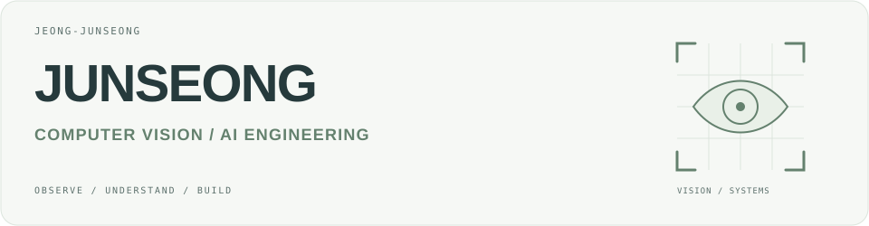
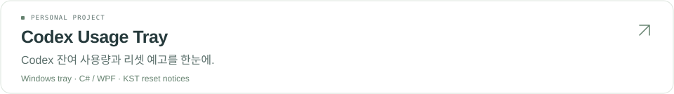
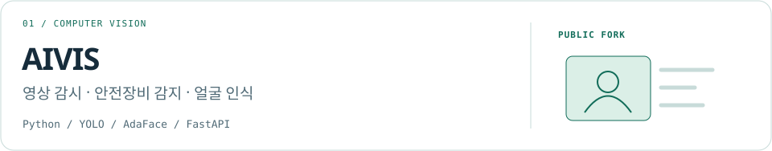
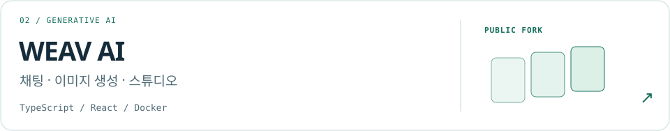

<picture>
  <source media="(max-width: 600px) and (prefers-color-scheme: dark)" srcset="./assets/header-mobile-dark.svg">
  <source media="(max-width: 600px)" srcset="./assets/header-mobile-light.svg">
  <source media="(prefers-color-scheme: dark)" srcset="./assets/header-dark.svg">
  
</picture>

 

<table>
  <tr>
    <td width="960" valign="middle">
      <strong>이미지에서 의미를, 모델에서 쓸모를.</strong>  
      컴퓨터 비전과 AI 모델을 
      실제로 쓰이는 도구로 연결합니다.  
      <a href="https://github.com/JEONG-JUNSEONG?tab=repositories">Repositories ↗</a>
    </td>
    <td width="40%" align="center" valign="middle">
      
    </td>
  </tr>
</table>

### Focus & tools

| | 기술과 관심사 |
| :--- | :--- |
| **Vision** | Python · YOLO · AdaFace · FAISS · ONNX Runtime |
| **Services** | FastAPI · React · TypeScript |
| **Desktop** | C# · WPF · .NET Framework |

### Selected repositories

<a href="https://github.com/JEONG-JUNSEONG/codex-usage-tray">
  <picture>
    <source media="(max-width: 600px) and (prefers-color-scheme: dark)" srcset="./assets/codex-tray-mobile-dark.svg">
    <source media="(max-width: 600px)" srcset="./assets/codex-tray-mobile-light.svg">
    <source media="(prefers-color-scheme: dark)" srcset="./assets/codex-tray-dark.svg">
    
  </picture>
</a>

<a href="https://github.com/JEONG-JUNSEONG/AIVIS">
  <picture>
    <source media="(max-width: 600px) and (prefers-color-scheme: dark)" srcset="./assets/aivis-mobile-dark.svg">
    <source media="(max-width: 600px)" srcset="./assets/aivis-mobile-light.svg">
    <source media="(prefers-color-scheme: dark)" srcset="./assets/aivis-dark.svg">
    
  </picture>
</a>

Forked from [Ihan0316/AIVIS](https://github.com/Ihan0316/AIVIS)

<a href="https://github.com/JEONG-JUNSEONG/WEAV-AI">
  <picture>
    <source media="(max-width: 600px) and (prefers-color-scheme: dark)" srcset="./assets/weav-mobile-dark.svg">
    <source media="(max-width: 600px)" srcset="./assets/weav-mobile-light.svg">
    <source media="(prefers-color-scheme: dark)" srcset="./assets/weav-dark.svg">
    
  </picture>
</a>

Forked from [dongbinr56-maker/WEAV-AI](https://github.com/dongbinr56-maker/WEAV-AI)

---

Observe carefully. Build thoughtfully.
